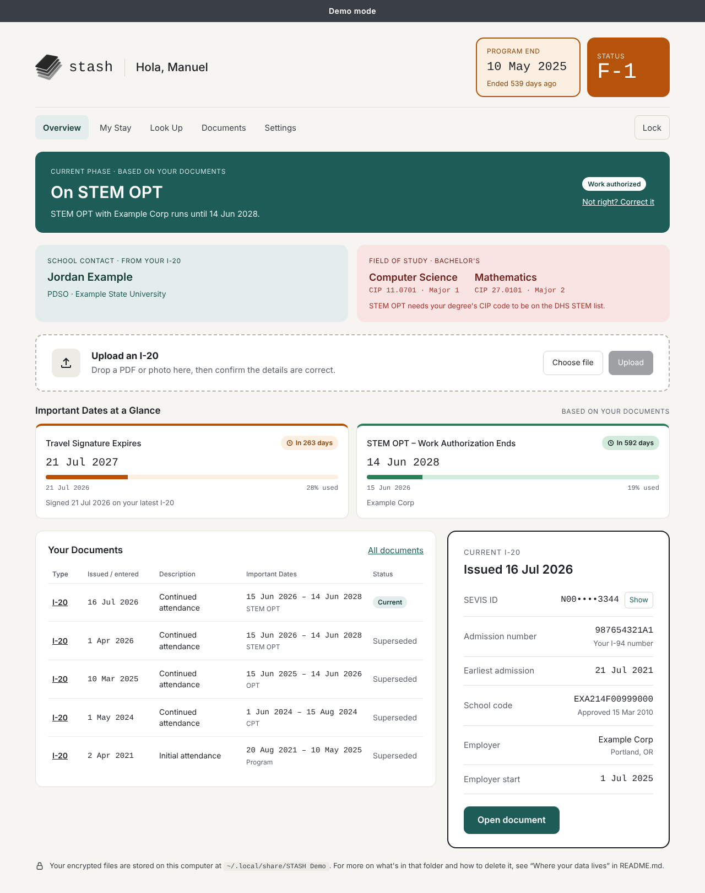
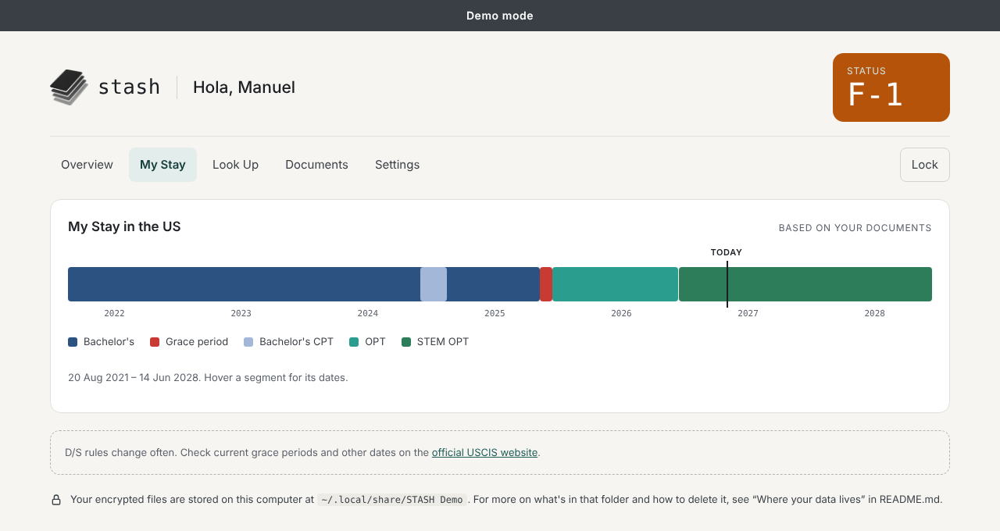
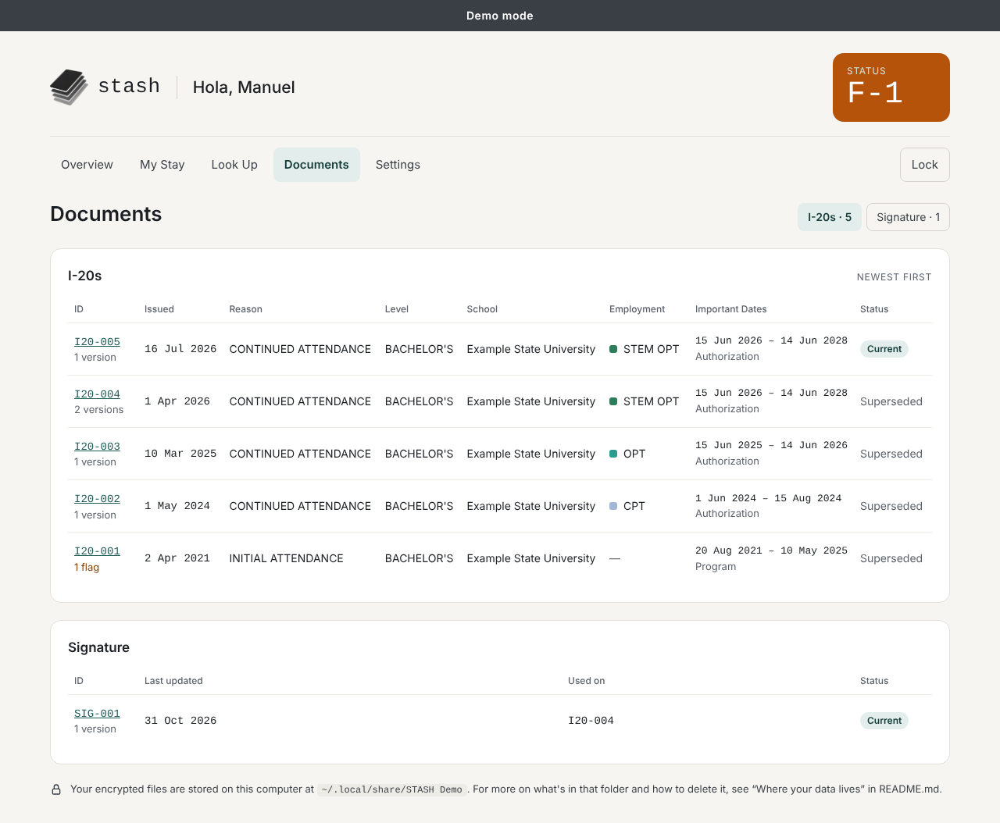

# STASH

**Your I-20s, organized, searchable and encrypted, on your own computer.**

STASH is a free, open-source tool for F-1 students. Upload your I-20s and STASH reads the key details, checks
signatures, and shows what matters at a glance: when your travel signature expires, how long your OPT or STEM OPT
runs, and a timeline of your whole stay. Everything stays on your computer, encrypted. There's no account, no cloud
and no company holding a copy.

> **Early preview: I-20s only.** I-94s and visa pages are next. STASH is not legal advice. Immigration rules
> change, so check dates with your DSO and on [uscis.gov](https://www.uscis.gov/).



*Every screenshot shows a fake demo student. No real documents appear anywhere in this repo.*

## What it does

- **Reads your I-20s for you.** Upload a PDF and STASH reads the SEVIS ID, issue reason, program dates, school,
  travel signatures, work authorization (CPT, OPT, STEM OPT), employer, majors with CIP codes, and more. You check
  the result on a review screen, and nothing is saved until you press Save.
- **Keeps every version.** Each I-20 gets its own ID (I20-001, I20-002...). Signing creates a new version; your
  original is never changed.
- **Records what the document got wrong.** If your DSO made a typo, you keep the value exactly as printed and add
  the correction next to it.
- **Shows what matters now.** The Overview shows your current phase (enrolled, on OPT...), what's expiring, your
  DSO, your field of study and your current I-20.
- **Draws your stay.** My Stay is a timeline of your programs, CPT, grace periods, OPT and STEM OPT.
- **Answers "what was true on this date?"** Look Up shows which I-20, program and travel signature applied on any
  day you pick.
- **Lets you sign.** Draw or upload your signature once, then place it on an I-20.





## Why it isn't a web app

Your I-20 holds your SEVIS ID, your school, your employer and your immigration history. A website would mean
sending all of that to someone else's server and trusting them to protect it, forever. STASH takes the other route:

- **It runs only on your computer.** It's a small app you open in your browser at `127.0.0.1`, an address only your
  own machine can reach. Other devices on your Wi-Fi can't connect.
- **Nothing leaves your machine.** No analytics, no cloud document reading, no outside fonts or scripts. Reading
  your I-20 happens locally.
- **Everything is encrypted**, behind a passphrase only you know. Lose the laptop, and the data is unreadable.
- **No one can see your data, including the people who wrote STASH.** There's no server to hack and no database of
  students to leak.

The tradeoff is a few setup steps, below. A packaged desktop app may come later.

## Quick start

You need **Python 3.11 or newer** ([python.org/downloads](https://www.python.org/downloads/)) and about 200 MB of
disk space. STASH is written in Python, so there's nothing to compile: you install the dependencies and run it.

**macOS and Linux**

```bash
git clone https://github.com/<your-username>/STASH-OSS.git
cd STASH-OSS
python3 -m venv .venv
source .venv/bin/activate
pip install -r requirements.txt
python manage.py migrate
python manage.py runserver
```

**Windows (PowerShell)**

```powershell
git clone https://github.com/<your-username>/STASH-OSS.git
cd STASH-OSS
py -3 -m venv .venv
.venv\Scripts\Activate.ps1
pip install -r requirements.txt
python manage.py migrate
python manage.py runserver
```

Then open **http://127.0.0.1:8000**. On your first visit, STASH asks you to create a passphrase (12 characters or
more) and shows a **recovery key once**. Write the recovery key down and keep it somewhere offline. Without the
passphrase or the recovery key, nobody can open your data, and that includes you.

To start STASH again later: open a terminal in the folder, activate the environment (`source .venv/bin/activate`,
or `.venv\Scripts\Activate.ps1` on Windows) and run `python manage.py runserver`. Stop it with Ctrl+C.

## Try the demo first

The demo loads a fake student, so you can click around before trusting STASH with your own documents.

```bash
python manage.py demo                    # Manuel: bachelor's, CPT, OPT, then STEM OPT with a worksite move
python manage.py demo --student priya    # Priya: master's student on CPT right now
python manage.py demo --student amara    # Amara: started a master's after OPT (change of level)
```

Open **http://127.0.0.1:8001** and unlock with the passphrase **`stash-demo`**.

- A charcoal "Demo mode" bar sits on every page, so demo screenshots are never mistaken for real ones.
- The demo uses its own data folder (`STASH Demo`), which is deleted and rebuilt every time you run it. Your real
  data is never touched.
- It runs on port 8001, so you can keep your real STASH open on 8000 at the same time.
- Dates are worked out from today, so the demo always shows someone mid-OPT, on CPT now, or just starting a new
  degree.

Taking screenshots for an issue or a post? **Use the demo.** Never share screenshots of your own documents.

## Using your own I-20s

1. On the Overview, choose a PDF of your I-20 (or drag it onto the upload card).
2. Check what STASH read. Fields marked **Check** or **Missing** need a look. Fix anything wrong, or mark that the
   document itself has an error and add the correct value.
3. Press **Save I-20**.
4. If you haven't signed it yet, use **Sign this I-20** to place your signature and date.

Photos and scans can be uploaded and stored, but STASH can't read them yet (no OCR), so you'll type the fields in.

**Checking a real I-20 without sharing it.** If STASH misreads your I-20, this prints the form's layout with every
value masked (letters become `x`, digits become `9`), so you can share the output in an issue safely:

```bash
python manage.py structure_check path/to/your-i20.pdf
```

## Where your data lives

Your data folder sits outside the code folder:

| OS | Folder |
| --- | --- |
| macOS | `~/Library/Application Support/STASH/` |
| Windows | `%LOCALAPPDATA%\stash\STASH\` |
| Linux | `~/.local/share/STASH/` |

The footer of every page shows the exact location. To use another folder, set the `STASH_DATA_DIR` environment
variable. STASH refuses any folder inside the code folder, so your documents can't end up in git.

It holds `keys.json` (your locked key), `stash.sqlite3` (encrypted fields) and `files/` (encrypted documents). Back
up the whole folder; it's useless without your passphrase or recovery key.

**To delete everything:** stop STASH, then delete that folder. On macOS:
`rm -rf ~/Library/Application\ Support/STASH`. Deleting the code folder alone removes none of your data. Also check
for copies of your PDFs outside STASH: email attachments, Downloads, Trash and backups.

**To delete one document:** open it in STASH and use **Delete this document**. Every version goes with it.

## How your data is protected

- The app binds to `127.0.0.1` and rejects requests from anywhere else.
- Files and fields are encrypted with AES-256-GCM. Your passphrase is stretched with Argon2id, so guessing is slow.
- STASH locks itself after 15 minutes idle.
- Uploads are checked by content, capped at 20 MB, and read in a separate sandboxed process with a time limit.
- Pages and files are never cached by your browser.

The full threat model, including what STASH can't protect against, is in [SECURITY.md](SECURITY.md).

## Dependencies

All versions are pinned in `requirements.txt` and installed with `pip install -r requirements.txt`.

| Package | What STASH uses it for |
| --- | --- |
| Django | The app itself: pages, forms, the local database |
| cryptography | AES-256-GCM encryption of every file and field |
| argon2-cffi | Turning your passphrase into a key (Argon2id) |
| pdfplumber, pdfminer.six | Reading text and layout from I-20 PDFs |
| pypdf | Detecting digital signatures, adding your signature as a new version |
| pypdfium2 | Drawing page 1 so you can place your signature |
| reportlab | Drawing your signature and date onto the PDF; making the fake demo I-20s |
| Pillow | Checking image uploads, cleaning up signature images |
| platformdirs | Finding the right data folder for your OS |

## Running the tests

```bash
python manage.py test tests
```

The tests use fake I-20s only. They cover the full upload, review, sign and save flow, encryption at rest, locking,
the recovery key, the demo, and the Overview rules.

## Project layout

```
vault/       passphrase, keys, encryption, the lock, local-only checks
documents/   upload, PDF reading (pdfread.py), review, signing, the demo students
dashboard/   Overview, My Stay, Look Up, Settings
templates/   shared page layout
static/      styles and small scripts (no outside resources)
scripts/     make_sample_i20.py: generates fake I-20s
tests/       automated tests
```

## Feedback and contributing

This is an early preview, and feedback from other students shapes what comes next.

- **Bugs:** open an issue with the **Bug report** template.
- **Use cases and ideas:** open an issue with the **Use case or idea** template. Tell us what situation you're in
  and what you need to keep track of.
- **Security problems:** please don't open a public issue. Report them privately through the repo's
  **Security** tab → **Report a vulnerability**. See [SECURITY.md](SECURITY.md).
- **Code:** see [CONTRIBUTING.md](CONTRIBUTING.md).

Never attach real documents, or screenshots of them, to an issue. Use the demo or the masked structure check.

## Roadmap

- I-94s: entry dates on the timeline, and the Last US Entry card
- F-1 visa page: visa stamp expiry
- A Missing tab that points out gaps, such as an I-20 you don't have on file
- Reading photos and scans (local OCR, never a cloud service)
- A packaged desktop app

## Support

STASH is a personal open-source project, maintained in spare time. Issues are read and answered on a best-effort
basis, with no guaranteed response time. It is not legal advice and comes with no warranty (see the license).

## License

[MIT](LICENSE)
